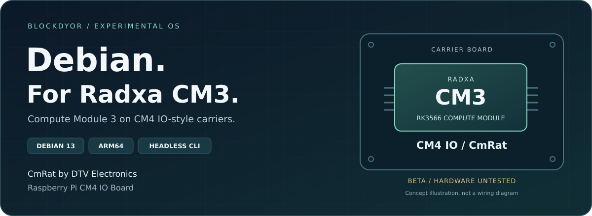

<p align="center">
  
</p>

<h1 align="center">Debian for Radxa CM3</h1>

<p align="center">
  <strong>A headless Debian 13 image for the Radxa Compute Module 3.</strong><br>
  For CM4 IO-style carrier boards, with a focus on <strong>CmRat by DTV Electronics</strong>.
</p>

<p align="center">
  <a href="https://github.com/blockdyor/radxa-cm3-debian-cli/releases/tag/v0.1.0-beta.1"></a>
  
  
  
</p>

<p align="center">
  <a href="https://github.com/blockdyor/radxa-cm3-debian-cli/releases/tag/v0.1.0-beta.1"><strong>Download Beta 1</strong></a> &nbsp;·&nbsp;
  <a href="docs/cm3-beta1.md">Installation guide</a> &nbsp;·&nbsp;
  <a href="#compute-module-and-carrier-boards">Hardware target</a> &nbsp;·&nbsp;
  <a href="#verification-and-build-evidence">Verification</a> &nbsp;·&nbsp;
  <a href="https://github.com/blockdyor/radxa-cm3-debian-cli/pkgs/container/radxa-cm3-debian-cli">GHCR package</a>
</p>

---

A fresh-install, command-line Debian image for the **Radxa CM3 / Rockchip RK3566**. The project targets the **Raspberry Pi CM4 IO Board carrier configuration**, identified by `radxa-cm3-rpi-cm4-io`, and documents its intended use with **DTV Electronics' CmRat** carrier. There is no desktop environment.

> **Experimental beta. Software and scoped virtual validation passed; physical hardware validation has not been performed.** This release is for development and evaluation, not production or unattended deployment. It does not establish real board boot, peripheral compatibility, target systemd or active LSM behavior.

## Compute module and carrier boards

**Radxa CM3 is the computer; the carrier board provides its external connections.** This is not an image for the Raspberry Pi Compute Module 3 or CM4. The name “CM4 IO” refers to the carrier-board target, not a Raspberry Pi processor.

- **Radxa Compute Module 3 (CM3):** the RK3566-based module that runs the ARM64 operating system.
- **Raspberry Pi CM4 IO Board:** the carrier configuration named by the exact build target, `radxa-cm3-rpi-cm4-io`.
- **CmRat by DTV Electronics:** a particular focus of this project. The [CmRat hardware repository](https://github.com/DTVElectronics/cmrat) documents a carrier designed for modules including Radxa CM3. See our [CmRat installation notes](docs/cm3-beta1.md#cmrat-carrier-verified-scope-versus-expected-behavior) for the distinction between software validation and untested board behavior.

These names describe the intended hardware setup, **not a claim that every CM4-compatible carrier is electrically interchangeable**. Check the exact module and carrier revisions. CmRat switch positions, USB recovery routing, SD/eMMC boot precedence and peripherals remain physically untested.

## What is included

- **Debian 13 Trixie, ARM64, CLI only.** A headless base for development and small server projects.
- **CM3 board-support packages.** The release includes its kernel, U-Boot, overlays and package manifest for the named target.
- **Key-based owner enrollment.** No default login or password; the owner configuration must be provisioned offline before first boot.
- **One image for the documented SD and eMMC paths.** Guarded OS-root expansion is limited to the selected MMC partition layout. NVMe boot/root is outside this beta.
- **Verification material alongside the image.** Checksums, scoped validation reports, corresponding sources/notices and reviewed recovery evidence are part of the release.

## Download and install

**[Download v0.1.0-beta.1 from GitHub Releases](https://github.com/blockdyor/radxa-cm3-debian-cli/releases/tag/v0.1.0-beta.1)** · Published November 2, 2026.

Canonical image:

```text
radxa-cm3_debian-13-trixie_arm64_cli_v0.1.0-beta.1.img.xz
```

1. Download the image **and its verification/source material** from the release page.
2. Follow the [signature and checksum verification instructions](docs/cm3-beta1.md#download-verification) before writing any media.
3. Choose the documented [microSD](docs/cm3-beta1.md#flash-to-microsd-on-macos-windows-or-linux) or [eMMC](docs/cm3-beta1.md#emmc-installation--separate-destructive-recovery-workflow) installation path. Writing an image erases the selected target; preserve data disks and stop if device identity is ambiguous.
4. Provision the required owner configuration **offline before first boot**, as explained in the [installation guide](docs/cm3-beta1.md). There is no universal login or password.

Do not substitute Raspberry Pi `rpiboot` instructions for Rockchip recovery. The [guide](docs/cm3-beta1.md) explains the limits of the documented RK3566 recovery procedure, first boot, root expansion and rescue paths. This is a fresh installation, not a supported upgrade from another distribution.

## Verification and build evidence

The compressed image SHA-256 is:

```text
e189249e76a527b1680b4c1667ca58c923ab59d7567e1792b8019cc537c72e57
```

The image was built from `b71152296933808f99d7dc169fc6811861a9001b`. Its recovery-signing source is `e46c9e137b17a986ce0378bb4b579f6de4004549`; these are different revisions with different roles.

**Scope matters:** original image assembly succeeded, but that producer's overall run failed and its original build-provenance job was skipped. The release carries a separately verified, custom review-recovery attestation based on independently reviewed local evidence, **not original trusted-builder provenance**. Read the release's `RECOVERY-VERIFICATION.txt`, `validation-report.txt` and `KNOWN-LIMITATIONS.txt` before use. Checksums alone do not authenticate a download.

The executed software checks and scoped virtual probes do not establish retained-BSP boot, target systemd, active LSM, physical carrier compatibility or power-loss recovery. The full hardware matrix and limitations remain in the release. Historical image2 remains NO-PUBLISH; this release uses retained image3, with no fourth OS image built.

## Companion package on GHCR

The [public GHCR package](https://github.com/blockdyor/radxa-cm3-debian-cli/pkgs/container/radxa-cm3-debian-cli) contains the same 24 release assets for archival distribution and automation:

```text
ghcr.io/blockdyor/radxa-cm3-debian-cli:0.1.0-beta.1
```

Immutable OCI digest:

```text
sha256:c73e39347a86a6def34eec67eb637c6712bbfab4e2da0aa266551b377eb0b344
```

**This is an OS-asset archive, not a runnable container.** Use GitHub Releases for normal installation. The release's `OCI-USAGE.txt` describes digest-based pull and export; there is no `latest` tag. The [publication workflow](https://github.com/blockdyor/radxa-cm3-debian-cli/actions/runs/41440663848) verified the reviewed wrapper, registry roundtrip and repository association.

## Documentation and upstream projects

- [Beta installation, verification and recovery guide](docs/cm3-beta1.md)
- [Build instructions and engineering status](docs/cm3-cli/build.md)
- [First-boot details](docs/cm3-cli/first-boot.md)
- [Validation scope](docs/cm3-cli/validation.md)
- [DTV Electronics CmRat hardware](https://github.com/DTVElectronics/cmrat)
- [RadxaOS RSDK](https://RadxaOS-SDK.github.io/rsdk/), the upstream build framework this repository is based on

A **blockdyor** project. CmRat is a carrier board by **DTV Electronics**; the compute module is by **Radxa**. Original component licenses apply. Keep the corresponding sources, copyright notices and redistribution terms with the image; the repository license does not relicense the operating system or its components.
